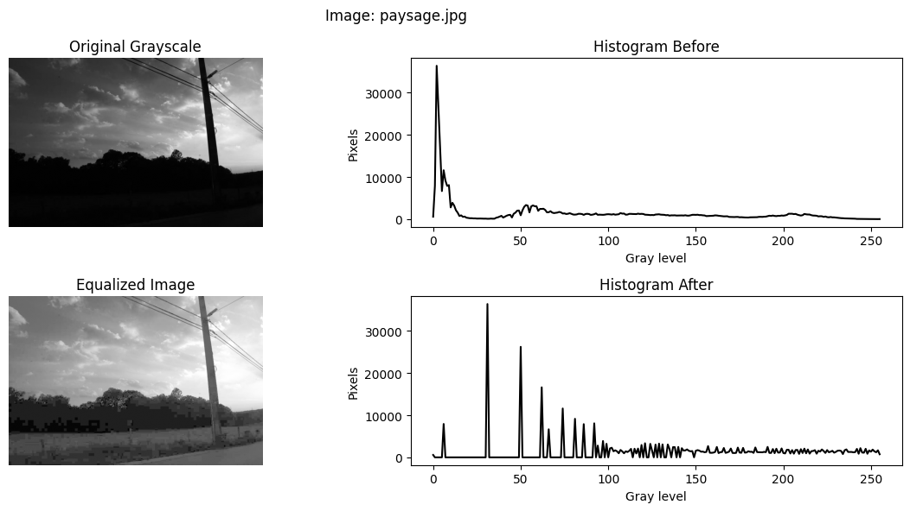
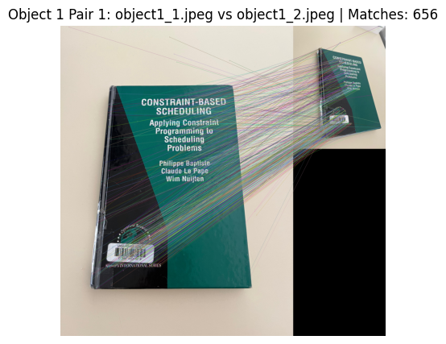
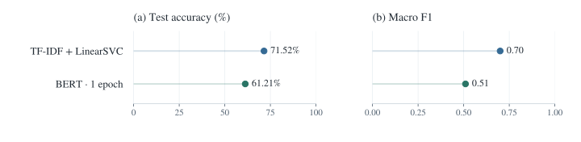
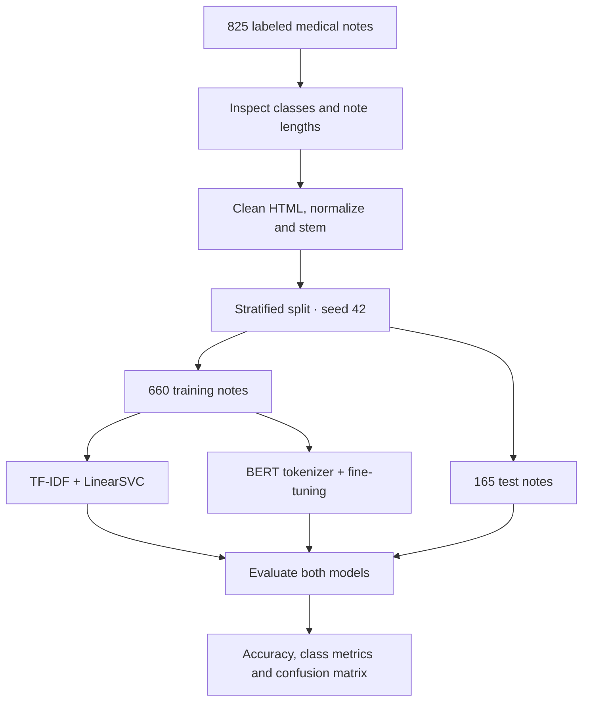

# AI and Applications

### Computer vision and NLP practical assignments · Polytech Tours

Python coursework completed during my Erasmus exchange at **Polytech Tours, Université de Tours**, for **IA et Applications (UE3.S9)**. This repository covers two modules: **Image and Video Processing and Analysis** and **Automatic Language Processing**.

I worked on image filtering, segmentation and feature matching with OpenCV, then text preprocessing and medical notes classification with a TF-IDF/SVM baseline and BERT. The notebooks include code, saved outputs and written reports.

**Python · OpenCV · NumPy · pandas · scikit-learn · NLTK · Hugging Face Transformers · PyTorch · Matplotlib**

[Computer vision](computer-vision/README.md) · [NLP](nlp/README.md) · [Experiment details](docs/experiments.md) · [Running the notebooks](docs/running.md)

## At a glance

| Work | Technical skills | Evidence |
| --- | --- | --- |
| **Image processing** | Histograms, contrast enhancement, convolution, smoothing, Laplacian and Canny edges | [OpenCV notebook](computer-vision/TP1.ipynb) |
| **Segmentation and matching** | Otsu thresholding, morphology, contours, watershed and SIFT descriptor matching | [Visual results](computer-vision/README.md#selected-results) |
| **Preprocessing experiments** | Seven combinations of lowercasing, stop-word removal and stemming; TF-IDF + LinearSVC; stratified holdout | [TP2 notebook](nlp/TP2.ipynb) |
| **Medical text classification** | HTML cleaning, exploratory analysis, scikit-learn Pipeline, BERT tokenization and fine-tuning with Hugging Face Trainer | [TP4 notebook](nlp/TP4.ipynb) |
| **Model evaluation** | Accuracy, per-class precision/recall/F1, confusion matrix and comparison of saved runs | [Results and setup](docs/experiments.md) |

## Computer vision: inspect the output

| Contrast enhancement | Feature matching |
| --- | --- |
|  |  |

These are outputs saved in the coursework notebook. The module also covers noise reduction, edge detection, cell counting and a basic video frame-processing loop.

## NLP: compare a baseline with BERT

**Task:** classify medical notes into five specialties. The notebook loads **825 labeled notes**, inspects class and text-length distributions, cleans the text and uses a **stratified 80/20 split: 660 training and 165 test notes**.

| Model | Test accuracy | Setup |
| --- | ---: | --- |
| TF-IDF + LinearSVC | **71.52%** | scikit-learn Pipeline; TF-IDF fitted on the training set |
| `bert-base-uncased` | **61.21%** | 1 epoch, batch size 8, learning rate `5e-5`, maximum length 128 tokens |

The baseline performed better in this run. BERT used one epoch and truncated inputs to 128 tokens; both approaches received the same cleaned text, including stemming. These choices limit what the comparison says about the models more broadly. [Full protocol and interpretation →](docs/experiments.md)

## Repository guide

| Location | Contents |
| --- | --- |
| [`computer-vision/`](computer-vision/) | Original OpenCV notebook and HTML export, with a guide to the exercises |
| [`nlp/`](nlp/) | TP2 preprocessing comparison, TP4 classification experiment and TP1 teaching examples |
| [`docs/reports/`](docs/reports/) | My original submitted reports |
| [`docs/course-materials/`](docs/course-materials/) | Instructor-provided assignment documents |
| [`assets/`](assets/) | Selected saved figures and a chart derived from recorded accuracy values |
| [`docs/experiments.md`](docs/experiments.md) | Dataset distinctions, parameters, results and limitations |
| [`docs/running.md`](docs/running.md) | Input files, Colab assumptions and environment notes |

## Course context and attribution

The [official 2025–2026 course handbook](https://polytech.univ-tours.fr/medias/fichier/livret-specialite-di-2025-2026-vf_1762957156585-pdf?ID_FICHE=326727&INLINE=FALSE) lists **IA et Applications** in semester S9. This repository presents work from its computer vision and language-processing modules.

**My coursework submissions** are the OpenCV practical, TP2 preprocessing experiments, TP4 medical notes experiment and the accompanying reports. The `help_*.ipynb` files in [`nlp/TP1/`](nlp/TP1/) are guided course examples for preprocessing, LSA and Word2Vec. Their inclusion documents the material studied; it does not imply that I authored those teaching examples.

The original notebooks, saved outputs and PDFs are preserved. Organization and documentation were added for easier review; the experiments have not been rerun as part of this cleanup.
