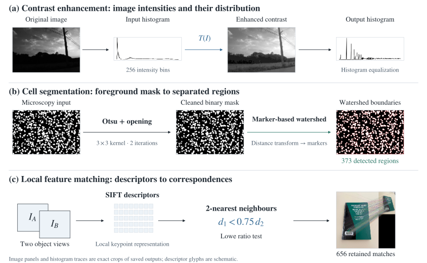
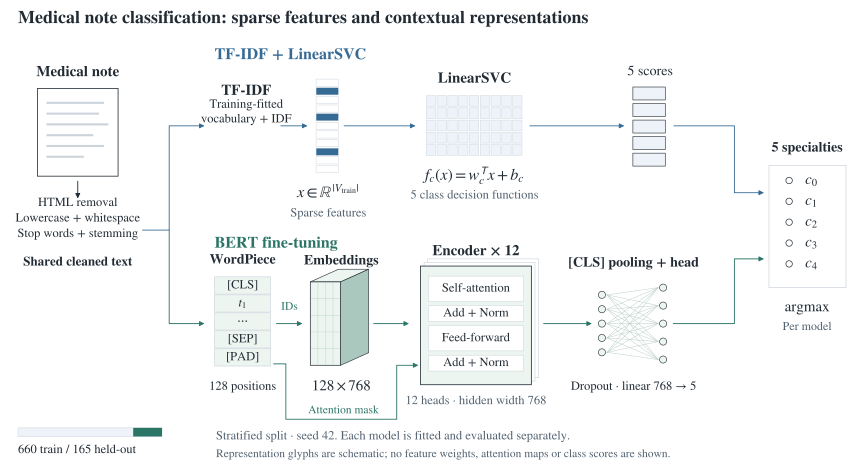

# AI and Applications

Image processing and medical text classification in Python. I implemented contrast enhancement, cell segmentation and SIFT matching with OpenCV, then compared a TF-IDF/LinearSVC baseline with a fine-tuned BERT classifier.

**Python · OpenCV · NumPy · pandas · scikit-learn · NLTK · Hugging Face Transformers · PyTorch · Matplotlib**

[OpenCV notebook](computer-vision/TP1.ipynb) · [Preprocessing experiments](nlp/TP2.ipynb) · [Medical notes notebook](nlp/TP4.ipynb)

## Image processing and local features

The OpenCV exercises examine how intensity distributions, spatial operators and local descriptors change the information extracted from an image.

**Figure 1.** Implemented methods and saved outputs. The contour and watershed counts describe detected regions; no reference count is available to measure counting accuracy. [Implementation details](computer-vision/README.md).

| Contrast enhancement | Feature matching |
| --- | --- |
|  |  |

**Figure 2.** Original notebook outputs. The module guide also includes edge maps and the cell segmentation result.

## Medical note classification

**Task:** assign a medical note to one of five specialties: Gastroenterology, Neurology, Orthopedic, Radiology or Urology. The recorded dataset contains **825 notes**, split into **660 training** and **165 held-out** samples with label stratification.

### Method

**Figure 3.** Data preparation, representations and classification heads in TP4. TF-IDF learns its vocabulary and IDF weights from training text. BERT uses the pretrained `bert-base-uncased` encoder through Hugging Face `BertForSequenceClassification`. [Method and source references](docs/methods.md).

### Recorded results

**Figure 4.** Results from the saved TP4 classification reports. Accuracy is shown to two decimal places; macro F1 is available at the report's two-decimal precision.

The baseline performed better in this run. Both models received stemmed text, while BERT was trained for one epoch with a 128-token limit. This is one recorded configuration on one split. [Per-class results](nlp/README.md#where-the-models-differ) · [Experiment protocol](docs/experiments.md).

## Preprocessing experiments

TP2 compares seven combinations of lowercasing, stop-word removal and Porter stemming using TF-IDF + LinearSVC. Its synthetic dataset has **14 specialties** and **1,000 held-out notes**. All seven saved reports print accuracy as **0.73**, with differences in class-level scores. This is a separate dataset from the five-specialty TP4 experiment. [TP2 setup and results](nlp/README.md#tp2-preprocessing-experiments).

## Repository guide

| Location | Contents | Start here |
| --- | --- | --- |
| [`computer-vision/`](computer-vision/) | OpenCV exercises, saved figures and HTML export | [Module guide](computer-vision/README.md) |
| [`nlp/`](nlp/) | Preprocessing experiments, medical note classification and guided TP1 examples | [Module guide](nlp/README.md) |
| [`docs/reports/`](docs/reports/) | Submitted coursework reports | [Image processing](docs/reports/image-processing.pdf) · [NLP](docs/reports/nlp.pdf) |
| [`docs/`](docs/) | Methods, experimental settings and input requirements | [Experiments](docs/experiments.md) · [Execution notes](docs/running.md) |
| [`assets/`](assets/) | Research diagrams, recorded metrics plots and original saved outputs | [Figure sources](assets/README.md) |

*Practical coursework for IA et Applications (UE3.S9): Image and Video Processing and Analysis, and Automatic Language Processing. Completed during my Erasmus semester at [Polytech Tours, Université de Tours](https://polytech.univ-tours.fr/version-francaise/navigation/cycle-ingenieur/informatique).*
