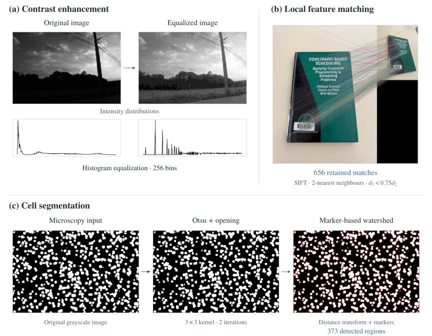

# AI and Applications

I used OpenCV to compare two ways of counting cells that touch in a microscopy image. I also matched features between photographs of the same book taken from different angles. In a separate experiment, I trained a linear SVM and fine-tuned BERT to predict a medical note’s specialty. I tested both classifiers on the same 165 held-out notes.

[OpenCV notebook](computer-vision/TP1.ipynb) · [Text preprocessing notebook](nlp/TP2.ipynb) · [Medical note classification notebook](nlp/TP4.ipynb)

## Image processing and local features

An intensity threshold can leave touching cells connected. I counted contours larger than 8.5 px² and found **328 candidate regions**. I then used a distance transform to place markers inside the cells so watershed could separate neighbouring regions. That method gave **373 regions** on the same image. The exercise has no reference count to establish which estimate is closer.

**Figure 1.** (a) Grayscale intensities before and after histogram equalization. (b) Matching features across two views of a book. (c) The microscopy image, its cleaned binary mask and the watershed boundaries. [Methods and parameters](computer-vision/README.md).

In the book example, I kept a SIFT match when the nearest descriptor was less than 0.75 times as far away as the second-nearest descriptor. **656 matches** passed that test for the two photographs shown.

## Medical note classification

I trained two classifiers to assign each note to one of five specialties (Gastroenterology, Neurology, Orthopedic, Radiology or Urology). I used a stratified split of the **825 notes** to preserve the specialty proportions in the **660 training notes and 165 held-out notes**. Both models received the same cleaned, stemmed text.

**Figure 2.** The SVM scores five specialties from a sparse vector of term weights. BERT uses the pooled first-token representation to score the same five labels. [Representations and model dimensions](docs/methods.md#medical-note-classification).

### Recorded results

The TF-IDF and linear SVM baseline classified **118 of 165 notes correctly (71.52%)**. BERT classified **101 correctly (61.21%)** after one epoch of fine-tuning. Their macro F1 scores were **0.70** and **0.51**, respectively.

**Figure 3.** Accuracy is the fraction of held-out notes classified correctly. Macro F1 gives each specialty equal weight. F1 is reported to the notebook’s two-decimal precision.

BERT correctly classified **3 of the 28 Neurology notes**. On Radiology, its F1 was **0.58**, compared with **0.53** for the SVM. BERT’s 128-token input included `[CLS]` and `[SEP]`, leaving room for at most 126 WordPiece tokens of note text. These results describe one split and one fine-tuning run. [Per-class results](nlp/README.md#where-the-models-differ) · [Training settings](docs/experiments.md).

## Preprocessing experiments

In a separate exercise, I tested seven combinations of lowercasing, stop-word removal and Porter stemming with TF-IDF and LinearSVC. The **synthetic** dataset had 14 specialties. All seven runs reported **0.73 accuracy** to two decimal places on the same 1,000 held-out notes, although individual specialties scored differently. [TP2 setup and results](nlp/README.md#tp2-preprocessing-experiments).

## Repository guide

| Resource | What to look for |
| --- | --- |
| [Computer vision](computer-vision/README.md) | Contrast, filters, cell counts and SIFT matches, with the notebook’s saved images. |
| [Language processing](nlp/README.md) | Guided text representations, the TP2 preprocessing comparison and the TP4 specialty classifiers. |
| [Experiments](docs/experiments.md) · [Methods](docs/methods.md) | Data splits, model settings and the classification report for each specialty. |
| [Execution notes](docs/running.md) · [Figure sources](assets/README.md) | Inputs needed to run the notebooks and commands to rebuild the figures. |
| [Vision report](docs/reports/image-processing.pdf) · [NLP report](docs/reports/nlp.pdf) | The original coursework submissions. |

*Practical coursework for IA et Applications (UE3.S9), completed during my Erasmus semester at [Polytech Tours, Université de Tours](https://polytech.univ-tours.fr/version-francaise/navigation/cycle-ingenieur/informatique).*
