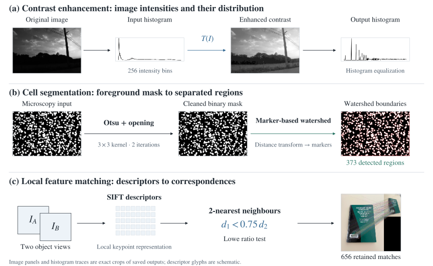
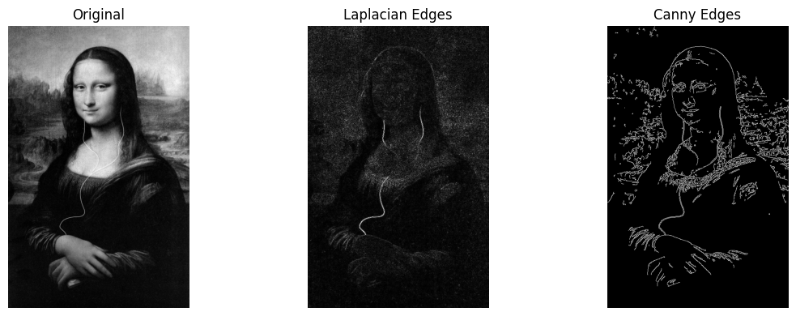
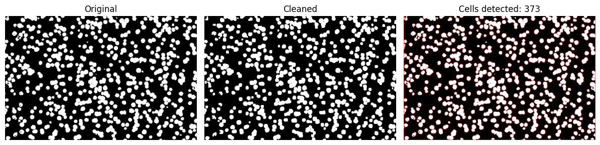
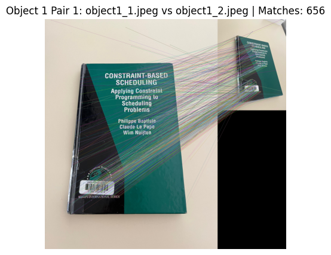

# Image and Video Processing and Analysis

[← Overview](../README.md) · [Notebook](TP1.ipynb) · [HTML export](TP1.html) · [My report](../docs/reports/image-processing.pdf)

OpenCV practical assignments from **IA et Applications**, Polytech Tours. The exercises progress from pixel intensities and filters to segmentation and local feature matching.

**Tools:** Python, OpenCV, NumPy and Matplotlib.

## Methods

**Figure 1.** Methods connected to their saved image outputs. The watershed counting path is shown; the contour baseline and other filtering exercises are listed below. Image panels and histogram traces are exact crops from the original figures. [Parameters and implementation](../docs/methods.md#image-processing-and-local-features).

## What the notebook contains

| Exercise | Implementation | What it demonstrates |
| --- | --- | --- |
| Grayscale intensity analysis | `cv2.calcHist`, 256 intensity bins | Reading and interpreting an image histogram |
| Contrast enhancement | `cv2.equalizeHist` | Comparing intensity distributions before and after equalization |
| Noise reduction | Mean filters with 5×5, 9×9 and 15×15 kernels; Gaussian and median filtering | Comparing smoothing and loss of detail |
| Convolution and edges | Directional kernels, Sobel, Laplacian and Canny | Extracting local intensity changes and comparing edge maps |
| Cell counting | Otsu thresholding, contours and area filtering | Turning a binary mask into a count of candidate objects |
| Touching-cell separation | Morphological opening, distance transform and watershed | Separating connected regions before counting |
| Object matching | SIFT, brute-force k-nearest-neighbor matching and Lowe's ratio test | Comparing local descriptors across different views |
| Rotated-icon comparison | Contour crops, resizing and comparison at quarter-turn rotations | Handling rotation in a small course image challenge |
| Video basics | `VideoCapture`, a frame loop and grayscale conversion | Reading and processing frames from a video file |

## Selected results

### Filtering and edge detection

The comparisons make the effect of each operator visible. Kernel size changes the amount of smoothing; edge detectors respond differently to noise and fine detail.

### Cell segmentation

The saved runs count **328 regions** with contour filtering and **373** in the later watershed-based experiment. These are algorithm outputs. Without an independently verified reference count, they do not establish counting accuracy.

### Feature matching

SIFT descriptors are matched across views, and Lowe's ratio test removes ambiguous matches. The notebook displays results for multiple image pairs. The number of retained matches is a diagnostic output, not a measured recognition accuracy.

## Files and execution

- [`TP1.ipynb`](TP1.ipynb): original notebook, including saved code and outputs.
- [`TP1.html`](TP1.html): original browser-readable export; download it to view locally.
- [Submitted report](../docs/reports/image-processing.pdf): explanations of the methods and observed results.
- [Assignment](../docs/course-materials/image-processing-assignment.pdf): instructor-provided exercise sheet.

The notebook refers to course inputs under `aimagesTPAI2023/` and `challenges/`. Those images and video files are not part of the current upload. Saved outputs can be inspected without them; rerunning the cells requires the inputs. See [execution notes](../docs/running.md).
