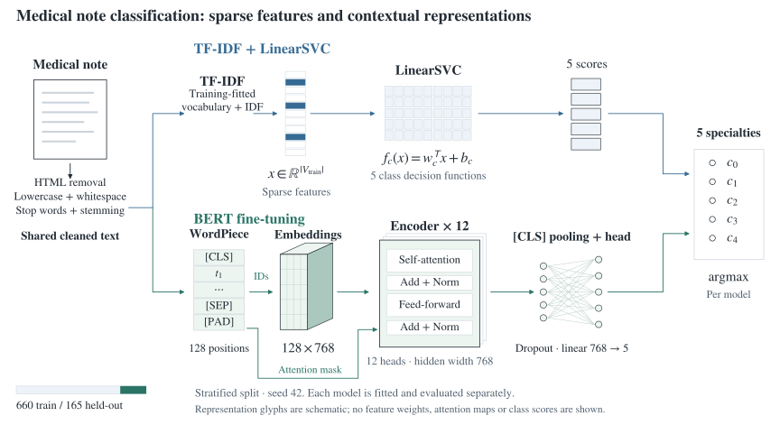
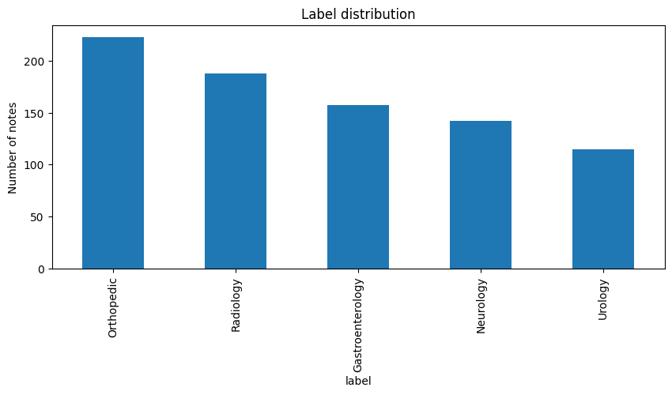
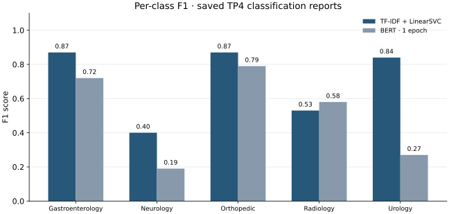
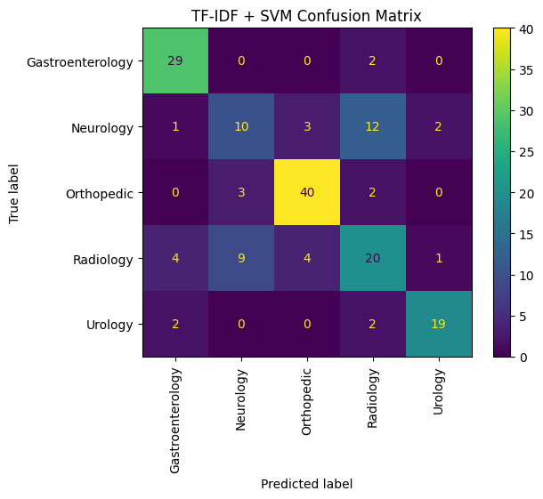

# Automatic Language Processing

[← Overview](../README.md) · [TP2](TP2.ipynb) · [TP4](TP4.ipynb) · [My report](../docs/reports/nlp.pdf)

Text preprocessing, representations and medical notes classification from **IA et Applications**, Polytech Tours.

**Tools:** Python, pandas, NumPy, NLTK, scikit-learn, Hugging Face Transformers/Datasets, PyTorch and Matplotlib. Guided Word2Vec examples use Gensim.

## Work by practical

| Practical | Scope | Files |
| --- | --- | --- |
| **TP1 — guided examples** | Tokenization, stop words, stemming, lemmatization, bag-of-words, LSA with TruncatedSVD and skip-gram Word2Vec | [`TP1/`](TP1/) |
| **TP2 — preprocessing comparison** | Seven combinations of lowercasing, stop-word removal and stemming with TF-IDF + LinearSVC | [`TP2.ipynb`](TP2.ipynb) |
| **TP4 — medical notes classification** | Dataset inspection, text cleaning, TF-IDF/SVM baseline, BERT fine-tuning and evaluation | [`TP4.ipynb`](TP4.ipynb) |

TP2 and TP4 use **different datasets**. Their scores should not be treated as results on the same benchmark.

## TP2: preprocessing experiments

The experiment uses the included [`synthetic_medical_notes.csv`](TP1/synthetic_medical_notes.csv). Each configuration applies a stratified 80/20 split with `random_state=42`, fits TF-IDF on the training text and evaluates LinearSVC on held-out notes.

The seven configurations are LOW, RSW, STM, LOW+RSW, LOW+STM, RSW+STM and LOW+RSW+STM. LOW means lowercasing, RSW stop-word removal and STM stemming.

All seven saved classification reports show **0.73 accuracy**, rounded to two decimals, over **1,000 test notes and 14 specialties**. Per-class scores differ. The overall score stays the same at that precision, while individual class scores change between configurations.

## TP4: from raw notes to model comparison

**Figure 1.** The same cleaned text is represented and classified by two models. The vector and tensor drawings are schematic. BERT is fine-tuned with Hugging Face Trainer. Its attention mask is passed to the encoder separately from the token embeddings. [Method and source references](../docs/methods.md#medical-note-classification).

### Data and preparation

The notebook downloads **Medical Notes 2019** through Kaggle, reads labels and note files, and records **825 samples across five specialties**. It counts notes in each specialty and measures their lengths before cleaning the text.

Cleaning removes HTML tags, lowercases text, normalizes whitespace, removes English stop words and applies Porter stemming. The same cleaned text is passed to both models.

### Baseline and fine-tuning

| Setting | TF-IDF + LinearSVC | BERT |
| --- | --- | --- |
| Input | Cleaned notes | The same cleaned notes |
| Split | 80/20, stratified, seed 42 | 80/20, stratified, seed 42 |
| Representation | TF-IDF, `stop_words="english"`, `max_df=0.9` | `BertTokenizerFast`, `bert-base-uncased` |
| Input length | Vocabulary-based sparse vectors | 128-token input, including `[CLS]` and `[SEP]` |
| Training | `Pipeline.fit()` | Hugging Face `Trainer`, PyTorch data format |
| BERT settings | — | 1 epoch; batch size 8; learning rate `5e-5`; weight decay `0.5` |
| Test accuracy | **0.7151515** | **0.6121212** |
| Macro F1, rounded | **0.70** | **0.51** |

The BERT training log records **1,247 seconds**, approximately 20.8 minutes, and reports that no accelerator was available. The notebook does not record SVM training time.

### Where the models differ

**Figure 2.** F1 scores from the saved classification reports, shown to two decimal places. Each pair of points compares the two models on the same specialty.

The baseline has higher F1 on four of the five specialties. BERT has slightly higher F1 on Radiology, but its recall is much lower on Neurology and Urology. These class results explain more of the difference between the models than overall accuracy alone.

See [experiment details](../docs/experiments.md) for the recorded metrics, setup and interpretation.

## Interpretation

I used the same split to compare a TF-IDF classifier with a pretrained Transformer. This involved fitting the text vectorizer, creating Hugging Face datasets, tokenizing notes, fine-tuning BERT and comparing the class reports.

Both models receive stemmed text. BERT uses a 128-token input including `[CLS]` and `[SEP]`, leaving at most 126 WordPiece tokens of note text. With one training epoch and no parameter search, the BERT result describes this particular setup rather than the best result the model could achieve.

## Guided material and reports

The `help_*.ipynb` notebooks in [`TP1/`](TP1/) are teaching examples. They demonstrate text normalization, SVD-based representations, explained-variance plots and Gensim Word2Vec. The practical notebooks apply text preprocessing and classification to the course datasets.

[My submitted report](../docs/reports/nlp.pdf) discusses the exercises and model comparison. [Instructor assignment documents](../docs/course-materials/) provide the task context. [Execution notes](../docs/running.md) describe the required inputs and Colab paths.
